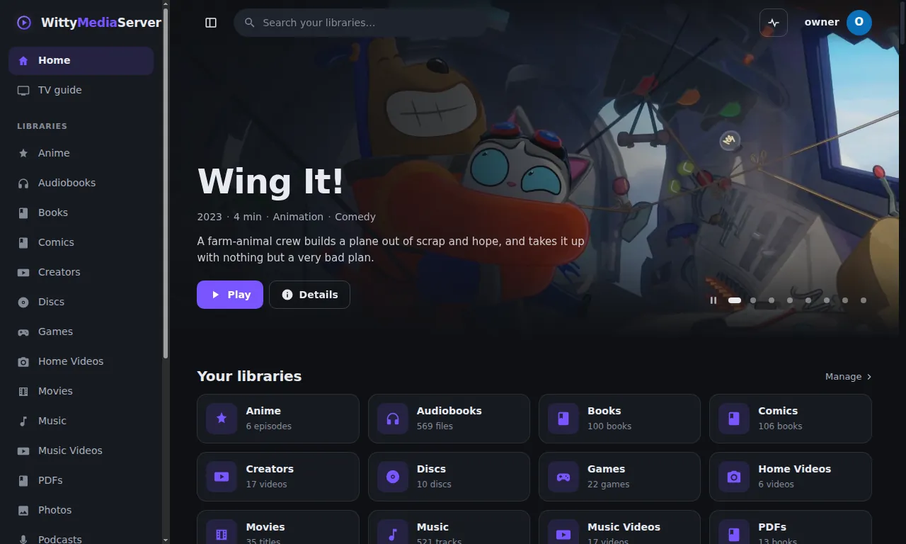
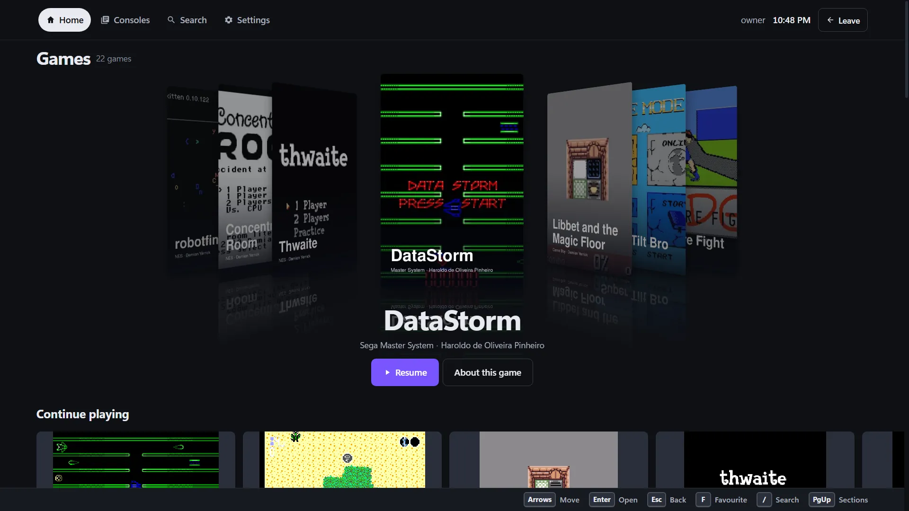
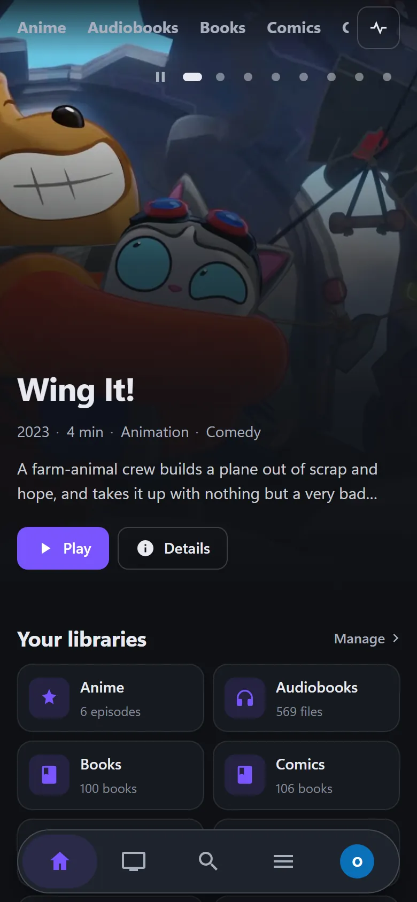

# WittyMediaClient

Apps that connect to a WittyMediaServer, for TV boxes, phones, tablets and desktops. You need one if you'd rather not use a browser on that device. Most of this is early, and [Platforms](#platforms) says how far each one has been run.

<!-- pictures -->



<sub>WittyMediaClient on a desktop, connected to a test server. From a test server. The server's [credits list](https://github.com/wittywilla/WittyMediaServer/blob/master/docs/images/CREDITS.md) names everything shown.</sub>



<sub>The big-screen view the app shows on a TV, here in a browser. From a test server. The server's [credits list](https://github.com/wittywilla/WittyMediaServer/blob/master/docs/images/CREDITS.md) names everything shown.</sub>



<sub>The server's pages at phone width, here in a browser. From a test server. The server's [credits list](https://github.com/wittywilla/WittyMediaServer/blob/master/docs/images/CREDITS.md) names everything shown.</sub>

<!-- /pictures -->

## What it does

- **Finds your server** on the network, or takes its address, and signs in with a code or a password. It checks the server's identity first.
- **Plays your films and shows,** with resume, on the native apps. The desktop app is a frameless window around the server's web interface, so it has everything the server has.
- **Works with a remote, a keyboard or a touch screen.**
- **Plays games on someone's own PC** through the server's page where it can, with the separately installed Moonlight app as the fallback. No part of that has reached a real PC from these apps yet.

Native apps say plainly that an item can't play yet, rather than failing, for anything but video and games on someone's own PC. Music and books need the desktop app or a browser for now.

| Folder | What it is |
|---|---|
| [`desktop/`](desktop) | Windows, macOS, Linux, FreeBSD and KDE's Plasma Bigscreen: a frameless window around the server's web interface, in Electron |
| [`android/`](android) | Android TV, Google TV, Fire TV, phones and tablets, one APK for ARM and x86, 32-bit and 64-bit: Kotlin, Compose, Media3 |
| [`apple/`](apple) | Apple TV, iPhone, iPad and Apple Vision Pro: SwiftUI, AVPlayer, laid out as the Android app. A Mac has the desktop app |
| [`shared/`](shared) | What every app shares, as plain data: themes, wording, button meanings and test cases |
| [`docs/`](docs) | [Installing and removing](docs/INSTALLING.md), [design](docs/DESIGN.md), [status](docs/PLATFORMS.md), [porting to TVs](docs/PORTING.md), [what the owner needs to do](docs/OWNER-STEPS.md) |

How to use your server is in **Help** inside WittyMediaServer.

### Logs

Each app keeps a small log of its own, and reports errors to the server it is connected to. Those reports go
to that server and nowhere else: there is no telemetry and no other address. The owner can turn them off with
"App errors" in the server's settings, and reads them in the server's log, under `clients`.

| App | The file | How to reach it |
|---|---|---|
| Desktop | `logs/client.log` in the app's data folder, 2 MB and three files at most | **Help** in the title bar: "Open logs folder" and "Copy diagnostic info". The connect screen has the link too |
| Android | `logs/client.log` in the app's private storage, 1 MB and three files at most | Profile, "This app's log". Errors reach the server's log |
| Apple | `logs/client.log` in the app's caches, 1 MB and three files at most | Not yet: no screen for it. Errors reach the server's log |

**What is kept and sent:** crashes, what stopped working in the app (with its reason and exit code), failed requests
with their request ID, playback errors with their stream ID, and failed connections, plus the app's version and
the system's name and version. The desktop app's file also has the address that failed, which isn't sent. The server's
page reports its own errors, so the desktop app doesn't repeat them.

**What never is:** tokens, passwords, cookies, stream addresses' secrets and file contents. Text is cleaned before it's
written anywhere, by the rules tested in `shared/data/redaction-cases.json`.

A report that fails is dropped. Repeats are grouped with a count, and nothing is ever tried again in a loop.

## How to get it

**Desktop.** Each release has installers, made by `electron-builder` from `desktop/`:

| You have | Download |
|---|---|
| Windows 10 or later | `wittymediaclient-<version>-windows-amd64-setup.exe` |
| A Mac with Apple silicon | `wittymediaclient-<version>-macos-arm64.dmg` |
| A Mac with an Intel chip | `wittymediaclient-<version>-macos-x64.dmg` |
| Debian, Ubuntu and relatives | `wittymediaclient-<version>-linux-amd64.deb` |
| Fedora and relatives | `wittymediaclient-<version>-linux-amd64.rpm` |
| Arch and relatives | `wittymediaclient-<version>-linux-amd64.pacman` |
| Any other Linux | `wittymediaclient-<version>-linux-amd64.AppImage` |
| FreeBSD, amd64 | `wittymediaclient-<version>-freebsd-amd64.pkg` |
| KDE Plasma Bigscreen | The `.deb`, `.rpm` or `.pacman` for its distribution |

They aren't code-signed yet, so Windows and macOS warn about them. Each upgrades in place and removes cleanly, down to your settings if you ask: [Installing and removing](docs/INSTALLING.md) has the steps and every folder involved.

The FreeBSD package holds only the app, under a megabyte, and uses the system's Electron from the ports tree, which `pkg` installs with it. See [porting](docs/PORTING.md#freebsd).

**On a TV with Plasma Bigscreen,** the Linux app opens as a TV app by itself: the whole screen, no title bar, the server's big screen mode, and everything reachable with arrows, Enter and Back. Install a `.deb`, `.rpm` or `.pacman` so it appears in the launcher, as an AppImage doesn't add itself to any. Anywhere else, `wittymediaclient --tv` asks for the same, and `--no-tv` turns it off inside Bigscreen. Back at the top of the app opens a small menu with Change server and Quit.

**Android.** Each release has a sideload `.apk`, the same one for phones and TVs. It's signed with a throwaway key and is for testing, so it can't update to a store version without uninstalling first. There's no store listing yet.

**iPhone, iPad, Apple TV, Apple Vision Pro.** There's nothing to download yet. They need a Mac to build.

## What it needs

- A WittyMediaServer to connect to. The native apps talk to its client API, which is in **Help** inside the server.
- **Desktop:** Windows 10 or later, macOS, Linux on x64, FreeBSD on amd64, or Plasma Bigscreen. It brings its own Electron, except on FreeBSD, where the package brings in the system's.
- **Android:** Android 6 or later, on ARM or x86, 32-bit or 64-bit, in one APK. Fire TV needs Fire OS 6 or later.
- **Apple:** iOS 16, tvOS 16, or visionOS 2, or later. A Mac has the desktop app.
- **Games on a PC:** the Moonlight app, installed separately, only where it's the fallback.

## Platforms

| Platform | Where it stands |
|---|---|
| Windows 10 and later | Run from source and as a packaged app. The setup and uninstaller ran under Wine, not on real Windows |
| Linux | `.deb`, `.rpm` and `.pacman` installed, opened on a virtual screen, upgraded and removed in containers. The `.rpm` also ran on Fedora 44 in a virtual machine, and it ran from source on Ubuntu 26.04 |
| FreeBSD 15.1 and 14.4, amd64 | In virtual machines, as an installed package: picture and sound seen on 15.1, as far as the connect screen on 14.4. Not a real FreeBSD desktop |
| KDE Plasma Bigscreen | The real shell in a virtual machine: opened from its launcher, video and sound seen, keys through the real input stack. Never on a TV or with a real remote |
| macOS | Packaged on a Mac for Apple silicon and Intel. The Apple silicon one was opened and used with a server on macOS 27 |
| Android TV | Run on an emulator, Android 16, with arrow keys and OK only |
| Android phones | Run on emulators, Android 16 and Android 6. Android 7 to 15 not run |
| Android on x86 and ARM | One APK carries all four. The emulators were 64-bit x86, and the other three are compiled, never run |
| Google TV, Fire TV, tablets | Compiled, never run |
| iPhone | Run in the iOS 27 simulator: connected, signed in, Home, a library, an item, and a film played. Never on a real iPhone |
| Apple TV, iPad, Apple Vision Pro | Compiled by Xcode 27 on a Mac, unsigned, for the devices and their simulators |

**No real device or remote has touched any of the Android builds,** and finding servers hasn't been tried on a real network anywhere. [Platform status](docs/PLATFORMS.md) says exactly what was seen and what wasn't.

## Building and testing

**Desktop.** You need [Node.js](https://nodejs.org) 22.12 or newer.

```bash
cd desktop
npm ci
npm start
```

```bash
npm test
```

```bash
npm run test:app
```

`npm test` runs the app's rules with no window. `test:app` runs the real app against a stand-in server on 127.0.0.1, with a window for a few seconds. It replaces the network search, so the Windows firewall doesn't ask anything, and opening a browser and the Help menu, so nothing outside it starts. Set `WMC_SHOTS` to a folder for a picture of each screen. `npm run package:win`, `package:linux` and `package:mac` make the installers, and `scripts/test` has the checks that really install them.

For a system that can't run the stand-in, such as a virtual machine, this runs the real app against a real server, with key presses alone, and plays a video. The server needs a film in its first library:

```bash
WMC_SERVER=http://192.168.1.20:8096 WMC_USER=me WMC_PASSWORD=... npm run test:real -- --tv
```

On FreeBSD, run Electron yourself, as the `electron` npm package has no build for it: `/usr/local/share/electron42/electron test/app/real-server.js --tv`. Set `WMC_APP` to an installed `app.asar` to test that instead of this folder.

In the app, Tab moves around the page. **F6** moves between the page and the title bar, where the arrow keys move along the bar and Escape goes back to the page. **Change server** signs out of the server you're leaving.

**Android.** CI uses Java 17 and Gradle 9.8.2.

```bash
cd android
gradle testDebugUnitTest lintSideload assembleSideload
```

```bash
sh scripts/check-abis.sh app/build/outputs/apk/sideload/app-sideload.apk
```

`lintSideload` is what keeps Android 6 honest: it fails on a call that version doesn't have. `check-abis.sh` says which processors the APK carries, and fails if a native library is missing for any of the four.

**Apple.** Run on any system with Swift:

```bash
cd apple/WittyKit
swift test
```

The apps themselves need a Mac and XcodeGen: see [what the owner needs to do](docs/OWNER-STEPS.md).

**Shared data.** The sample server answers those tests use are checked against a real server with `WMS_TOKEN=<token> node shared/scripts/check-fixtures.mjs <server address>`. After a theme changes in the server, rerun `node shared/scripts/build-themes.mjs` with a clone of WittyMediaServer beside this one, or `WMS_THEMES` set to its `themes` folder. CI fails if `shared/data/themes.json` is out of date.

## Licence

Apache-2.0: see [LICENSE](LICENSE) and [NOTICE](NOTICE). Any redistribution must keep the NOTICE attribution.

Third-party parts, by the app that ships them, are listed in full in [NOTICE](NOTICE):

- **Desktop:** Electron (MIT), which bundles Chromium and FFmpeg. Their licences ship with every build, in `LICENSE.electron.txt` and `LICENSES.chromium.html`.
- **Android:** AndroidX, Jetpack Compose, Media3, ZXing core, Coil, OkHttp, Okio, Kotlin and its libraries (all Apache-2.0), and Bouncy Castle (MIT).
- **Apple:** only Apple's own system frameworks.

Moonlight is a GPL-3.0 program these apps only start. Nothing of it is copied, linked or bundled.

## Legal

WittyMediaClient is an independent open-source project. It isn't associated with, sponsored by or
endorsed by any device or platform maker, publisher, rights holder or service. It connects to a
server its owner runs. What's on that server is theirs, not this project's: the project, its
contributors and affiliates don't provide, host, endorse or check it. Any third-party names here
only describe what it works with, and belong to their owners. It's provided “as is”, with no
warranty; see [LICENSE](LICENSE). Local law applies to how you use it. This isn't legal advice.
